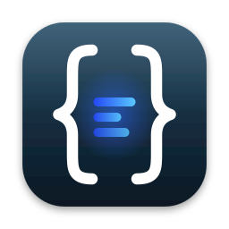

<p align="center"></p>

# The MongoDB GUI

A free, native MongoDB client for macOS. Browse your collections, run queries, and edit documents
without an account, a trial, or a license fee.

[](https://github.com/bjornharvold/the-mongodb-gui/actions/workflows/ci.yml)
[](https://github.com/bjornharvold/the-mongodb-gui/releases/latest)
[](#license)

**Website:** <https://bjornharvold.github.io/the-mongodb-gui/> ·
**Download:** [latest release](https://github.com/bjornharvold/the-mongodb-gui/releases/latest) ·
**Changes:** [CHANGELOG.md](CHANGELOG.md)

> **Status: early.** The app is at version 0.x. The core browsing and editing flow is built and
> tested, but it has had little real-world use. Expect rough edges, and keep backups of data you
> edit. See [Known limitations](#known-limitations).

## What it does today

**Connect**
- Saved connections with SCRAM, X.509 and LDAP (PLAIN) authentication, TLS, replica sets and SRV
  (`mongodb+srv://`) URIs.
- Kerberos (GSSAPI) support is included but **experimental**: it compiles and links against macOS
  GSS.framework but has not been tested against a real KDC.
- SSH tunnel through a bastion host (password or private key). Host keys are checked against an
  app-owned `known_hosts` file. An unknown host asks you to trust it, and a **changed** host key is
  refused outright with an option to forget the old key.
- Passwords and SSH secrets live in the macOS Keychain. They are never written to the
  connections file, logs, or error messages.

**Browse and query**
- Sidebar with databases and collections, loaded on demand.
- View the same page of documents as a **tree**, a **table** or **JSON**, 50 documents per page.
- Query bar with filter, sort, projection, skip and limit. Bad input shows an error and keeps your
  previous results on screen.

**Edit safely**
- Insert, edit, clone and delete documents. Edits use canonical extended JSON, so `Int32` and
  `Int64`, `Decimal128`, binary, dates, `MinKey`/`MaxKey` and the other BSON types keep their type.
- Works with any `_id` type (ObjectId, string, number, UUID, compound).
- Deleting a document or a saved connection asks you to confirm first.
- Pages shown with a projection are read-only for edit and clone, so a partial copy can never
  overwrite a full document.
- Unsaved editor text is kept if you click outside the editor.

## Install

1. Download `the-mongodb-gui-vX.Y.Z-macos-arm64.zip` from the
   [latest release](https://github.com/bjornharvold/the-mongodb-gui/releases/latest) (Apple Silicon).
2. Optionally check it: `shasum -a 256 -c the-mongodb-gui-vX.Y.Z-macos-arm64.zip.sha256`
3. Unzip it and move **The MongoDB GUI.app** to `/Applications`.
4. The app is **not notarized by Apple yet**, so the first launch is blocked by Gatekeeper.
   Right-click the app, choose **Open**, then **Open** again. Or remove the quarantine flag once:

   ```sh
   xattr -dr com.apple.quarantine "/Applications/The MongoDB GUI.app"
   ```

Only macOS on Apple Silicon (arm64) is built today. Other platforms are welcome contributions, see
[CONTRIBUTING.md](CONTRIBUTING.md#adding-a-platform).

## Quick start

1. Open the app and add a connection. Enter a URI **without** the password, for example
   `mongodb://localhost:27017`, then pick an authentication method and type the password into its
   own field. It is stored in the Keychain.
2. Select the connection and connect. Expand a database and click a collection.
3. Use the query bar. Filter, sort and projection are JSON:

   | Field      | Example                     |
   |------------|-----------------------------|
   | Filter     | `{"status": "active"}`      |
   | Sort       | `{"createdAt": -1}`         |
   | Projection | `{"name": 1, "email": 1}`   |

4. Right-click a document to edit, clone or delete it. Use the Tree, Table and JSON tabs to change
   how the page is shown.

To see failure details, launch the app from a terminal with logging on (levels: `error`, `warn`,
`info`, `debug`, `trace`; logging is off by default):

```sh
MONGOSTUDIO_LOG=warn "/Applications/The MongoDB GUI.app/Contents/MacOS/mongostudio"
```

## Known limitations

- macOS on Apple Silicon only, unsigned and not notarized.
- No inline editing in the table or tree. Documents are edited as JSON in the editor.
- Documents shown with a projection cannot be edited or cloned (delete and insert still work).
- Kerberos is untested against a real server.
- A TLS connection through an SSH tunnel is refused unless "allow invalid certificates" is on,
  because the driver cannot verify the certificate against the original host name. Turning that on
  removes certificate protection on the bastion-to-MongoDB leg.
- Only one SSH host per tunnel and single-host URIs are supported with a tunnel (no replica set
  discovery through a tunnel, no `mongodb+srv://`).
- The find bar takes strict JSON, not mongo shell syntax.
- Database-level tools you may expect from other clients (aggregation builder, import/export,
  index management, schema analysis) are intentionally not the focus. See the roadmap.

## Roadmap

The project focuses on features that free MongoDB tools do not already cover well. Ideas are listed
in rough order; each one gets its own design and plan before code is written, and each is a good
place to contribute:

- **Data Compare & Sync** ([#8](https://github.com/bjornharvold/the-mongodb-gui/issues/8)): diff two collections or databases (across servers), pick the
  differences, and apply or export the sync.
- **Data Masking and Reschema** ([#9](https://github.com/bjornharvold/the-mongodb-gui/issues/9)): anonymise sensitive fields in copies of data and
  reshape documents in bulk.
- **SQL and MongoDB** ([#10](https://github.com/bjornharvold/the-mongodb-gui/issues/10)): a SQL query editor that translates to MongoDB queries, plus SQL
  import.
- **Task Scheduler** ([#11](https://github.com/bjornharvold/the-mongodb-gui/issues/11)): save and schedule the jobs above to run unattended, with logs.
- **More platforms**: [Intel Mac (#14)](https://github.com/bjornharvold/the-mongodb-gui/issues/14), [Linux (#15)](https://github.com/bjornharvold/the-mongodb-gui/issues/15), [Windows (#16)](https://github.com/bjornharvold/the-mongodb-gui/issues/16).
- **Trust and polish**: [Apple code signing and notarization (#17)](https://github.com/bjornharvold/the-mongodb-gui/issues/17), [inline table editing
  (#12)](https://github.com/bjornharvold/the-mongodb-gui/issues/12), [`ssh-agent` support (#13)](https://github.com/bjornharvold/the-mongodb-gui/issues/13), [TLS test containers (#18)](https://github.com/bjornharvold/the-mongodb-gui/issues/18),
  [click-driven UI and screenshot tests (#19)](https://github.com/bjornharvold/the-mongodb-gui/issues/19), [real screenshots (#20)](https://github.com/bjornharvold/the-mongodb-gui/issues/20) and
  [translations (#21)](https://github.com/bjornharvold/the-mongodb-gui/issues/21).

Every item above has an issue with a description and a "done when" checklist. Browse them all by the
[`help wanted`](https://github.com/bjornharvold/the-mongodb-gui/issues/?q=is%3Aissue+is%3Aopen+label%3A%22help+wanted%22) and
[`good first issue`](https://github.com/bjornharvold/the-mongodb-gui/issues/?q=is%3Aissue+is%3Aopen+label%3A%22good+first+issue%22) labels.

## Build from source

You need macOS and Rust 1.87 or newer (see `rust-version` in `Cargo.toml`).

```sh
git clone https://github.com/bjornharvold/the-mongodb-gui.git
cd the-mongodb-gui
cargo run --release -p mongostudio      # build and launch
cargo test --workspace                  # unit tests (no network or docker needed)
```

Integration tests need Docker. See [docs/superpowers/notes/testing.md](docs/superpowers/notes/testing.md).

## Contributing

Contributions of every size are welcome, from a typo to a whole feature or a new platform. Start
with [CONTRIBUTING.md](CONTRIBUTING.md). In short:

- **Add a feature.** Pick something from the roadmap or open an issue to discuss your own idea first.
- **Support another platform.** Releases are built by a GitHub Actions matrix, and adding a row
  plus a packaging script is the whole job. The guide walks through it.
- **Fix bugs and improve docs.** Small pull requests are easy to review and get merged fast.

Commit messages follow [Conventional Commits](https://www.conventionalcommits.org/) because the
changelog and version numbers are generated from them.

## Releases and versioning

Versions follow [Semantic Versioning](https://semver.org/) (0.x while the app is young). Releases
are automated with [release-please](https://github.com/googleapis/release-please): merging to `main`
keeps a release pull request up to date; merging that pull request bumps the version, updates
[CHANGELOG.md](CHANGELOG.md), tags `vX.Y.Z`, creates the GitHub release and attaches the
macOS arm64 app as a zip with its SHA-256 checksum.

## Security

Please report vulnerabilities privately, see [SECURITY.md](SECURITY.md).

## Design documents

The original design and implementation plan live in
[docs/superpowers/specs](docs/superpowers/specs) and [docs/superpowers/plans](docs/superpowers/plans).

## License

Licensed under either of [Apache License, Version 2.0](LICENSE-APACHE) or [MIT license](LICENSE-MIT)
at your option. Unless you explicitly state otherwise, any contribution intentionally submitted for
inclusion in this project, as defined in the Apache-2.0 license, is dual licensed as above, without
any additional terms or conditions.

## Disclaimer

The MongoDB GUI is an independent open-source project. It is not affiliated with, endorsed by, or
sponsored by MongoDB, Inc. "MongoDB" is a registered trademark of MongoDB, Inc. The app is built
from public documentation and open-source libraries and contains no proprietary code.
